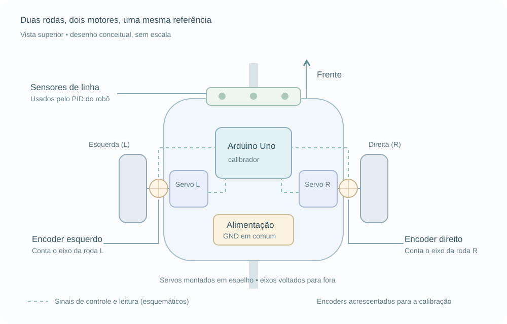

# Servo Calibrator

O Sketch é um calibrador de servomotores para Arduino que calibra um par de **servos de rotação contínua** com encoders. Identifica os pontos de parada e calcula ganhos por motor e sentido para equilibrar as velocidades de uma tração diferencial.



[Montagem física: fotos e suporte para impressão 3D](docs/montagem-fisica.md).

## Hardware e ligações

- Arduino Uno e cabo USB.
- Dois servos de rotação contínua, montados em espelho.
- Dois encoders com a mesma resolução, um por eixo.
- Alimentação dos servos dimensionada para sua tensão e corrente, com GND comum ao Arduino.

A montagem de referência utiliza servos MG996 de rotação contínua e sensores ópticos LM393. Esquerda e direita são definidas olhando para a frente do robô.

| Sinal            | Pino no Uno | Constante no sketch |
| ---------------- | ----------- | ------------------- |
| Servo esquerdo   | D6          | `LEFT_SERVO_PIN`    |
| Servo direito    | D5          | `RIGHT_SERVO_PIN`   |
| Encoder esquerdo | D2          | `LEFT_ENCODER_PIN`  |
| Encoder direito  | D3          | `RIGHT_ENCODER_PIN` |

Os encoders usam `INPUT_PULLUP` e interrupção na borda `RISING`. Ao trocar de placa, use pinos com suporte a interrupções externas e sinais compatíveis com seus níveis lógicos.

## Uso rápido

1. Monte o conjunto com as rodas livres para girar durante todo o ensaio.
2. Abra [calibrador_servo_motores.ino](calibrador_servo_motores.ino) na Arduino IDE. Instale a biblioteca **Servo**, caso necessário.
3. Confira a pinagem e os limites `PULSE_MIN_US` / `PULSE_MAX_US` conforme a especificação dos servos.
4. Selecione a placa **Arduino Uno** e a porta; carregue o sketch.
5. Abra o Monitor Serial em **115200 baud**. A rotina inicia automaticamente após o reset; com os valores padrão, reserve cerca de **3 minutos**.
6. Confira o status de cada sentido na tabela de calibração e copie o bloco `CODIGO PARA COPIAR` para seu projeto.

Ao terminar, os motores param. Para repetir a calibração, reinicie a placa.

O Plotter Serial exibe `L` e `R` em pulsos por janela de medição. Envie `p` para repetir a validação dos sentidos com status `OK`; os motores voltarão a girar. Monitor e Plotter compartilham a porta serial: use um de cada vez.

## Resultados

A saída contém os comandos de parada, mínimos e máximos medidos, além dos comandos calibrados, ganhos e erro por sentido.

Exemplo do bloco gerado — substitua pelos valores do seu ensaio:

```cpp
const int LEFT_STOP  = 1487;
const int RIGHT_STOP = 1487;

const float LEFT_GAIN_POSITIVE  = 0.7817;
const float RIGHT_GAIN_POSITIVE = 1.0000;
const float LEFT_GAIN_NEGATIVE  = 1.0000;
const float RIGHT_GAIN_NEGATIVE = 0.8908;
```

Os sentidos lógicos consideram os servos espelhados:

| Sentido    | Pulso esquerdo   | Pulso direito    |
| ---------- | ---------------- | ---------------- |
| `POSITIVE` | Acima da parada  | Abaixo da parada |
| `NEGATIVE` | Abaixo da parada | Acima da parada  |

Cada ganho corrige o desvio em relação à parada, usando o máximo medido daquele motor e sentido como referência:

```text
pulso = parada + ganho × (máximo_medido - parada)
```

Use os máximos da tabela `Parametros dos motores`, respeitando a correspondência de sentidos acima. O ganho vale para a condição ensaiada; sua aplicação em outras velocidades e cargas exige validação.

**`OK`** indica erro inferior à tolerância. **`NAO CONVERGIU`** mantém a melhor medição encontrada, mas os ganhos daquele sentido não foram validados. O bloco de constantes é impresso mesmo nesse caso.

## Ajustes

Constantes no início do sketch:

| Constante                       | Padrão             | Função                                                                     |
| ------------------------------- | ------------------ | -------------------------------------------------------------------------- |
| `PULSE_MIN_US` / `PULSE_MAX_US` | `1000` / `2000` µs | Limites de exploração dos servos.                                          |
| `SCAN_STEP_US`                  | `25` µs            | Passo da varredura; reduzi-lo aumenta resolução, duração e consumo de RAM. |
| `SETTLE_MS`                     | `500` ms           | Espera após alterar o comando.                                             |
| `MEASURE_MS`                    | `1000` ms          | Janela de contagem dos encoders.                                           |
| `TOLERANCE`                     | `0.05` (5%)        | Aceita quando `abs(L - R) / max(L, R) < TOLERANCE`.                        |

A rotina verifica a associação motor/encoder, encontra a faixa de parada e os limites de movimento, depois reduz o comando do motor mais rápido por busca binária em cada sentido. O máximo é o comando com maior contagem na varredura, não um limite mecânico.

## Diagnóstico

| Ocorrência                      | Verifique                                                                                   |
| ------------------------------- | ------------------------------------------------------------------------------------------- |
| Falha de correspondência        | Pinagem e associação entre motor e encoder.                                                 |
| Parada não identificada         | Tipo de servo, alimentação, faixa de pulsos e passo da varredura.                           |
| Ausência ou oscilação de pulsos | Alimentação, GND comum, alinhamento do encoder e carga mecânica.                            |
| `NAO CONVERGIU`                 | Estabilidade do conjunto e janela de medição; aumente `MEASURE_MS` se houver poucos pulsos. |

Para medir com comandos fixos, descomente `debugMotorPulses(1000, 1550);` no `setup()` e carregue novamente. Esse modo mantém os comandos até o reset e não executa a calibração. Comente a chamada e recarregue para retornar ao fluxo normal.

## Limitações

- As contagens são comparadas diretamente, sem conversão para RPM; os encoders precisam ter a mesma resolução.
- A busca pressupõe velocidade aproximadamente crescente com o desvio da parada.
- Picos de leitura podem afetar a escolha do máximo; movimento muito lento pode parecer parada.
- Motores DC com ponte H ou outra disposição dos servos exigem adaptação do código.
