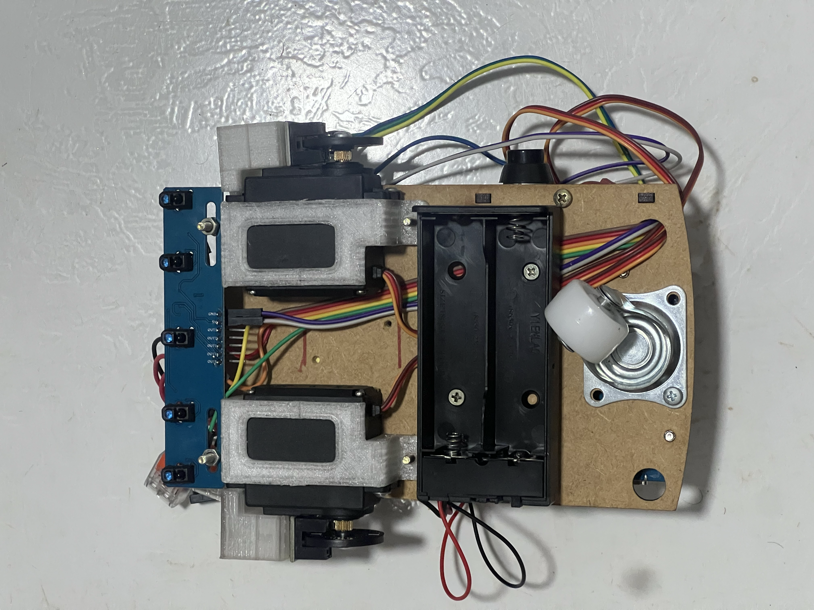
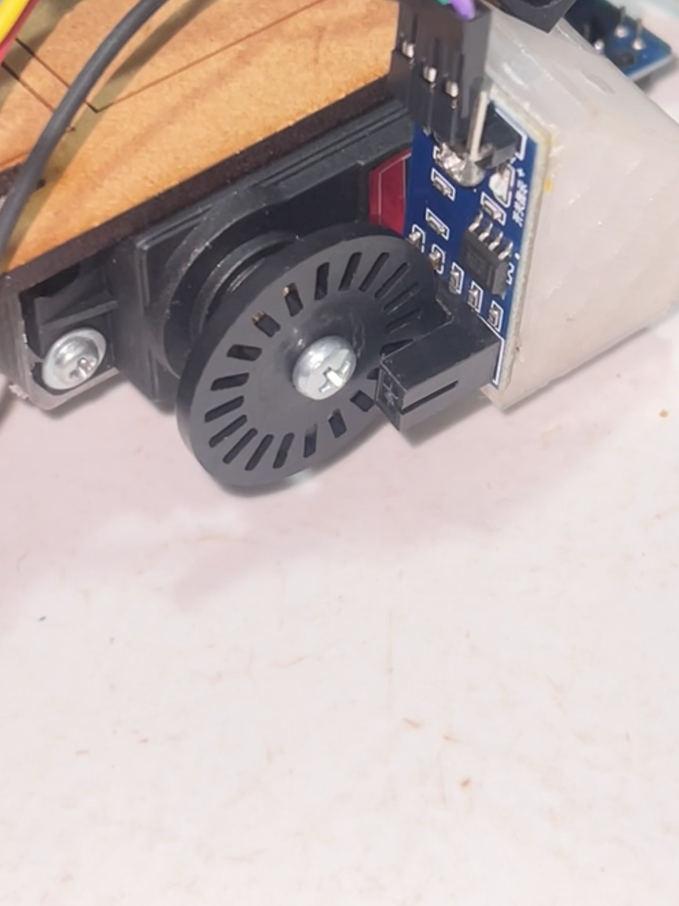

# Montagem física de referência

[← Documentação principal](../README.md)

  
  

À esquerda, vista inferior do robô com os servos em espelho. À direita, detalhe do disco do encoder e do sensor LM393 alinhado pelo suporte impresso.

## Suporte 3D

[Baixar o suporte do sensor em STL](calibrator-holder.stl). Modelo para impressão 3D, disponibilizado como sugestão de montagem.
